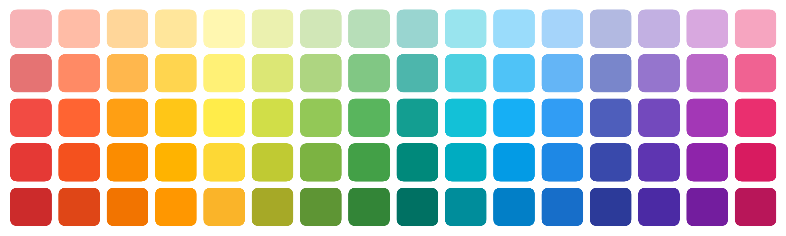
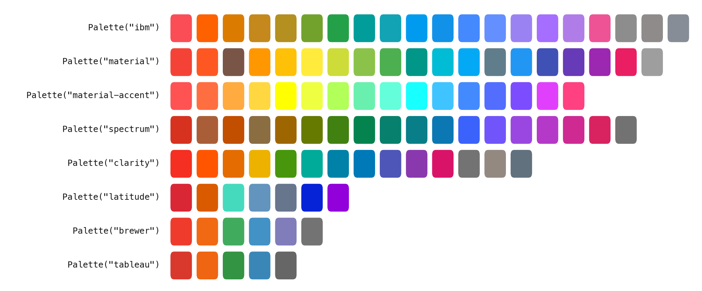
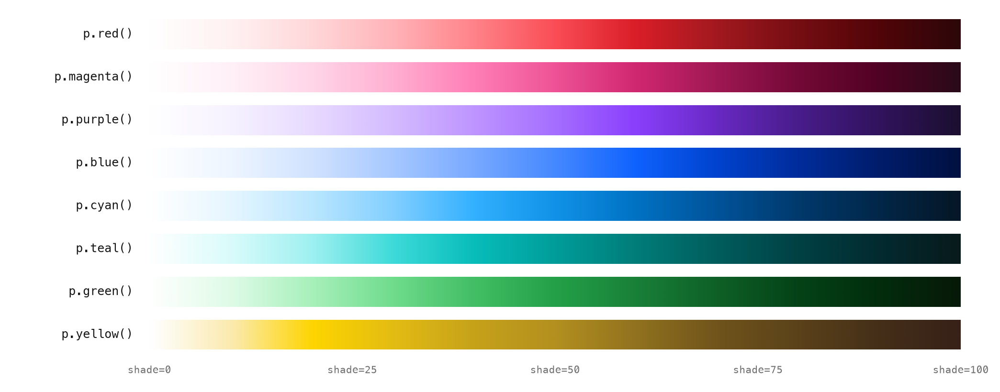
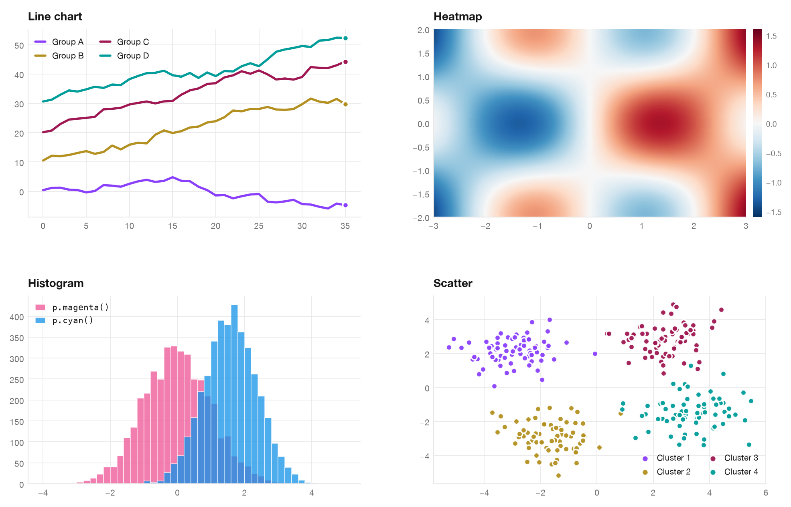
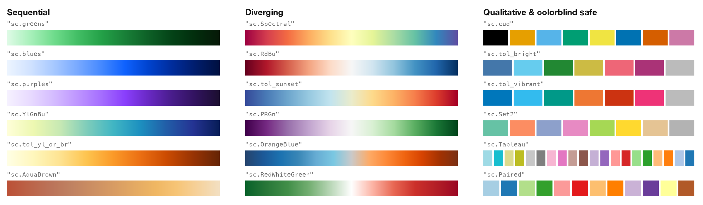
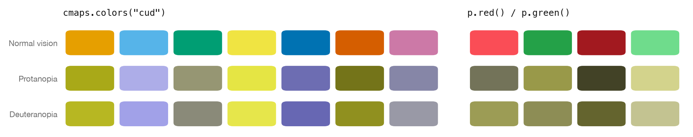
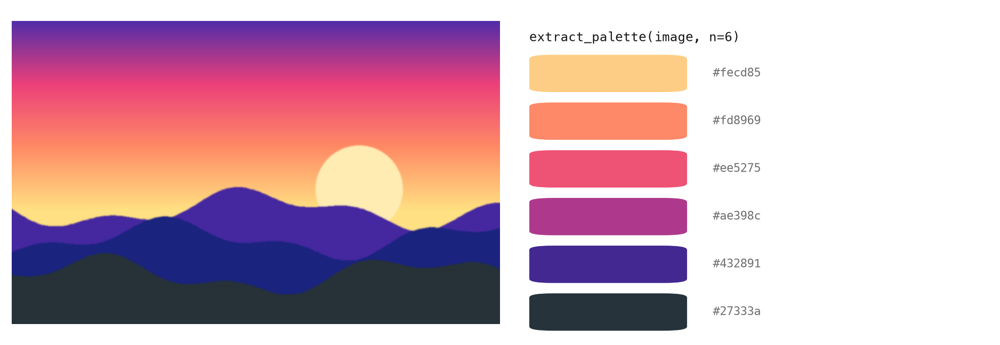
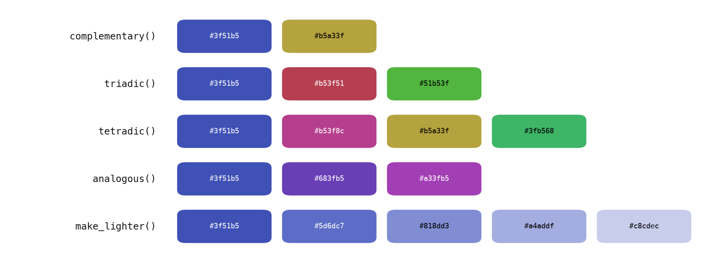

<div align="center">



# SecretColors

**Beautiful, ready-to-use color palettes and colormaps for Python.**<br>
IBM, Material, Adobe Spectrum, ColorBrewer, Tableau and colorblind-safe schemes - one simple API.

[](https://pypi.org/project/SecretColors/)
[](https://pypi.org/project/SecretColors/)
[](https://github.com/secretBiology/SecretColors/actions/workflows/tests.yml)
[](https://secretcolors.readthedocs.io)
[](https://pepy.tech/project/secretcolors)
[](LICENSE)

[Documentation](https://secretcolors.readthedocs.io) ·
[Changelog](CHANGELOG.md) ·
[PyPI](https://pypi.org/project/SecretColors/) ·
[Report a bug](https://github.com/secretBiology/SecretColors/issues)

</div>

---

## Why SecretColors?

- **Curated colors, not random hex codes** - palettes from well known design
  systems, each with a full range of shades.
- **Any shade you want** - `p.blue(shade=37.5)` works. Every color is a smooth
  gradient from white to its darkest tone.
- **Colormaps by name** - register once and write `cmap="sc.greens"` in
  matplotlib, pandas or seaborn.
- **Works everywhere** - plain hex output for plotly, bokeh, altair or CSS.
- **Colorblind friendly** - Okabe-Ito and Paul Tol schemes built in, plus
  simulation helpers.
- **Palettes from images** - pull the dominant colors out of any photo.
- **Color science included** - CIE L\*a\*b\*, LCh, Delta E (CIEDE2000) and 16
  RGB colorspaces.
- **Zero dependencies** - matplotlib is optional.

## Installation

```bash
uv add SecretColors          # or: pip install SecretColors
```

Optional extras

```bash
uv add "SecretColors[matplotlib]"   # matplotlib colormap objects
uv add "SecretColors[image]"        # palettes from images (Pillow)
uv add "SecretColors[all]"          # everything
```

The core library has no dependencies. Palettes, shades, `ColorWheel`,
conversions and `cmaps.colors()` work with a plain install. Features which
need an extra raise a clear `ImportError` telling you what to install.

## Quick start

```python
from SecretColors import Palette

p = Palette()                   # IBM palette (default)
p.red()                         # '#fa4d56'
p.red(shade=20)                 # '#ffd7d9'  lighter
p.red(shade=80)                 # '#750e13'  darker
p.blue(no_of_colors=5)          # ['#edf5ff', '#9bc0ff', '#2a75fe', '#0032a9', '#001141']

Palette("material").red()       # '#f44336'
```

Every color is a plain `str` (or `tuple`), so you can pass it straight to any
plotting library.

## Palettes

<picture>
  <source media="(prefers-color-scheme: dark)" srcset="docs/images/palettes-dark.png">
  
</picture>

| Name | Palette | Name | Palette |
|---|---|---|---|
| `ibm` | [IBM Design Language](https://www.ibm.com/design/language/color/) *(default)* | `clarity` | [VMware Clarity](https://clarity.design/) |
| `material` | [Google Material Design](https://m2.material.io/design/color/the-color-system.html) | `latitude` | [Flexport Latitude](https://github.com/auxdesigner/latitude) |
| `material-accent` | Material Design accent colors | `brewer` | [ColorBrewer](https://colorbrewer2.org/) |
| `spectrum` | [Adobe Spectrum](https://spectrum.adobe.com/page/color-palette/) | `tableau` | [Tableau](https://help.tableau.com/current/pro/desktop/en-us/formatting_create_custom_colors.htm) |

Need a color that is not in your palette? SecretColors looks for it in other
palettes, then in the standard [CSS / X11 color names](https://www.w3.org/TR/css-color-3/#svg-color).

```python
p = Palette()                   # IBM has no 'amber'
p.get("amber")                  # '#ffc107'  borrowed from Material
p.get("aquamarine")             # '#7fffd4'  CSS color name
p.get("grey"), p.get("k")       # ('#8d8d8d', '#000000')  synonyms work too
```

## Shades and gradients

<picture>
  <source media="(prefers-color-scheme: dark)" srcset="docs/images/shades-dark.png">
  
</picture>

```python
p.blue(shade=37.5)                                          # any value from 0 to 100
p.blue(no_of_colors=3, starting_shade=20, ending_shade=60)  # ['#d0e2ff', '#78a9ff', '#0f62fe']
p.blue(no_of_colors=4, gradient=False)                      # random shades
```

## Use it in your plots

<picture>
  <source media="(prefers-color-scheme: dark)" srcset="docs/images/examples-dark.png">
  
</picture>

Make SecretColors the default color cycle of matplotlib. This order of IBM
colors stays distinguishable for colorblind readers.

```python
import matplotlib.pyplot as plt
from cycler import cycler
from SecretColors import Palette

p = Palette()
plt.rcParams["axes.prop_cycle"] = cycler(color=[
    p.blue(shade=60), p.red(), p.teal(), p.purple(shade=60), p.orange()])

plt.hist(a, color=p.magenta(), alpha=0.75)
plt.hist(b, color=p.cyan(), alpha=0.75)
```

## Colormaps

<picture>
  <source media="(prefers-color-scheme: dark)" srcset="docs/images/colormaps-dark.png">
  
</picture>

Register once and use any of the 83 colormaps by name - exactly like
matplotlib's own. Each one also has a reversed `_r` version.

```python
from SecretColors import cmaps

cmaps.register()

plt.imshow(data, cmap="sc.greens")
plt.imshow(data, cmap="sc.Spectral_r")
df.plot.scatter(x="x", y="y", c="z", cmap="sc.tol_sunset")   # pandas
sns.heatmap(data, cmap="sc.RdBu")                           # seaborn
```

Fine tune a colormap, or pick another palette for the standard ones

```python
plt.imshow(data, cmap=cmaps.cmap("blues", start=20, end=80))
plt.imshow(data, cmap=cmaps.cmap("Spectral", n=9, reverse=True))
plt.scatter(x, y, c=labels, cmap=cmaps.cmap("Set2", n=4))     # discrete

cmaps.register(palette="material")      # sc.greens, sc.blues ... from Material
cmaps.available("brewer")               # list names by source
```

### Not using matplotlib?

`cmaps.colors()` returns plain hex colors and needs no extra dependency.

```python
cmaps.colors("Spectral", n=5)   # ['#d7191c', '#fdae61', '#ffffbf', '#abdda4', '#2b83ba']
```

| Library | Example |
|---|---|
| plotly | `px.imshow(data, color_continuous_scale=cmaps.colors("RdBu"))` |
| seaborn | `sns.color_palette(cmaps.colors("tol_bright"))` |
| bokeh | `figure.scatter(x, y, color=cmaps.colors("Tableau", n=3)[0])` |
| altair | `alt.Scale(range=cmaps.colors("tol_sunset"))` |

## Colorblind friendly

<picture>
  <source media="(prefers-color-scheme: dark)" srcset="docs/images/colorblind-dark.png">
  
</picture>

Red and green collapse into the same muddy tones for about 1 in 12 men.
Use the built in colorblind-safe schemes instead, and check your own colors
with the simulation helpers.

```python
cmaps.colors("cud")                     # Okabe-Ito (Color Universal Design)
cmaps.colors("tol_bright")              # Paul Tol's bright scheme
cmaps.available("colorblind")           # all 12 colorblind-safe schemes

from SecretColors.utils import simulate_green_blindness, hex_to_rgb
simulate_green_blindness(*hex_to_rgb("#fa4d56"))
```

## Palette from an image

<picture>
  <source media="(prefers-color-scheme: dark)" srcset="docs/images/image-palette-dark.png">
  
</picture>

Colors are clustered in the perceptual CIE L\*a\*b\* space, so the palette
matches what you see. Needs the `image` extra.

```python
from SecretColors.image import extract_palette

extract_palette("sunset.jpg")                       # 5 dominant colors, most common first
extract_palette("sunset.jpg", n=6, sort="lightness")
ColorMap().from_list(extract_palette("sunset.jpg")) # turn it into a colormap
```

## Color harmonies

<picture>
  <source media="(prefers-color-scheme: dark)" srcset="docs/images/harmonies-dark.png">
  
</picture>

`ColorWheel` finds colors that go well together.

```python
from SecretColors import ColorWheel

cw = ColorWheel("#3f51b5")
cw.complementary()          # ['#3f51b5', '#b5a33f']
cw.triadic()                # ['#3f51b5', '#b53f51', '#51b53f']
cw.analogous()              # ['#3f51b5', '#683fb5', '#a33fb5']
cw.make_darker(30)
cw.color                    # '#2c397f'
cw.text_color()             # '#ffffff'  readable text on this background
```

## More

<details>
<summary><b>Color modes and transparency</b></summary>

```python
Palette(color_mode="hex").green()               # '#24a148'
Palette(color_mode="hexa").green(alpha=0.5)     # '#24a14880'
Palette(color_mode="ahex").green(alpha=0.5)     # '#8024a148'
Palette(color_mode="rgb").green()               # (0.141, 0.631, 0.282)
Palette(color_mode="rgba").green(alpha=0.5)     # (0.141, 0.631, 0.282, 0.5)
```

Every returned color also knows its other forms

```python
c = Palette().red()
c.rgb                       # (0.980, 0.302, 0.337)
c.rgb255                    # (250, 77, 86)
c.hsl                       # (0.991, 0.945, 0.641)
c.blend("#ffffff")          # '#fca6ab'
```

</details>

<details>
<summary><b>Random colors and infinite color cycle</b></summary>

```python
p = Palette(seed=42)                    # reproducible, never touches global random state
p.random()                              # one random color
p.random(no_of_colors=3, shade=30)      # ['#a6c8ff', '#ffb3b8', '#c6c6c6']
p.random(no_of_colors=5, avoid=["gray"])
p.random_gradient(no_of_colors=5)       # gradient between two complementary colors

from itertools import islice
list(islice(p.cycle(), 5))              # ['#fa4d56', '#4589ff', '#e3bc13', '#24a148', '#08bdba']

for color in Palette("material"):       # iterate over all palette colors
    ...
```

</details>

<details>
<summary><b>Color science - Lab, Delta E and RGB colorspaces</b></summary>

```python
from SecretColors.utils import *

hex_to_lab("#ff0000")                       # (53.24, 80.09, 67.20)
lab_to_hex(53.24, 80.09, 67.20)             # '#ff0000'
lab_to_lch(*hex_to_lab("#ff0000"))          # (53.24, 104.55, 40.0)

delta_e("#fa4d56", "#fa4d57")               # 0.27  -> looks identical
delta_e("#fa4d56", "#4589ff")               # 44.47 -> clearly different

rgb_spaces()                                # 16 RGB colorspaces: srgb, adobe, pro_photo ...
rgb_to_xyz(0.2, 0.5, 0.1, space="pro_photo")
xyz_to_lab(0.5, 0.4, 0.3, reference="D50")
```

</details>

<details>
<summary><b>Conversions and utilities</b></summary>

```python
from SecretColors.utils import *

hex_to_rgb("#3f51b5")                       # (0.247, 0.318, 0.710)
rgb_to_hex(0.25, 0.32, 0.71)                # '#4052b5'
hex_to_hsl("#3f51b5")                       # (0.641, 0.484, 0.478)
color_in_between("#fa4d56", "#4589ff", 3)   # ['#cd5c80', '#a06baa', '#727ad5']
get_complementary("#fa4d56")                # '#4dfaf1'
text_color("#ffeb3b")                       # '#000000'
relative_luminance("#3f51b5")               # 0.1028 (WCAG 2.0)
```

Also available: `rgb_to_hsv`, `rgb_to_cmy`, `cmy_to_cmyk`, `srgb_to_linear`,
`simulate_red_blindness` and more. See the
[full API](https://secretcolors.readthedocs.io).

</details>

<details>
<summary><b>Upgrading from 1.x</b></summary>

Version 2.0 fixes many bugs and makes a few behaviour changes. The most
noticeable are

- Unknown palette names raise `ValueError` (earlier, IBM was used silently).
- `ColorString + "text"` is normal string concatenation. Use `.blend()` to mix colors.
- `hexa` / `ahex` alpha uses the 0-255 scale (opaque is now `ff`).
- `get_color_list` / `get_color_dict` are now `color_list` / `color_dict`.

Read the [changelog](CHANGELOG.md) for the full list.

</details>

## Development

```bash
git clone https://github.com/secretBiology/SecretColors.git
cd SecretColors
uv sync                                 # create .venv with test dependencies
uv run pytest                           # run tests
uv run tox                              # test on Python 3.10 - 3.14
uv run python scripts/readme_images.py  # regenerate README images
uv build                                # build sdist and wheel
```

Feedback and pull requests are very welcome. Open an
[issue](https://github.com/secretBiology/SecretColors/issues) or email
[rohitsuratekar@gmail.com](mailto:rohitsuratekar@gmail.com).
The story and inspiration behind this library is on the WeirdData blog[^blog].

## Acknowledgments

Colors are taken from [IBM Design Language](https://www.ibm.com/design/language/color/),
[Google Material Design](https://m2.material.io/design/color/the-color-system.html),
[ColorBrewer](https://colorbrewer2.org/), [VMware Clarity](https://clarity.design/)
[Tableau](https://help.tableau.com/current/pro/desktop/en-us/formatting_create_custom_colors.htm),
[Adobe Spectrum](https://github.com/adobe/spectrum-design-data) (Apache-2.0) and
[Flexport Latitude](https://github.com/auxdesigner/latitude) (MIT).
Colorblind-safe schemes are from Okabe & Ito[^okabe] and Paul Tol[^tol].
Color names are from [W3C CSS](https://www.w3.org/TR/css-color-3/#svg-color) and
[X11](https://gitlab.freedesktop.org/xorg/app/rgb/raw/master/rgb.txt).
RGB-XYZ matrices, white points and L\*a\*b\* formulas are from
[Bruce Lindbloom](http://www.brucelindbloom.com/). CIEDE2000 follows Sharma et al.[^sharma]
Any other resource is credited in the function where it is used.

## License

Released under the [MIT License](LICENSE).

[^blog]: Rohit Suratekar, [*Secret Colors*](https://weirddata.github.io/2019/06/11/secret-colors-2.html), WeirdData blog (2019).
[^okabe]: Okabe M. and Ito K., [Color Universal Design](https://jfly.uni-koeln.de/color/).
[^tol]: Paul Tol, [Colour Schemes](https://personal.sron.nl/~pault/).
[^sharma]: Sharma G., Wu W. and Dalal E. N., [The CIEDE2000 color-difference formula](https://hajim.rochester.edu/ece/sites/gsharma/ciede2000/), Color Research & Application, 2005.
